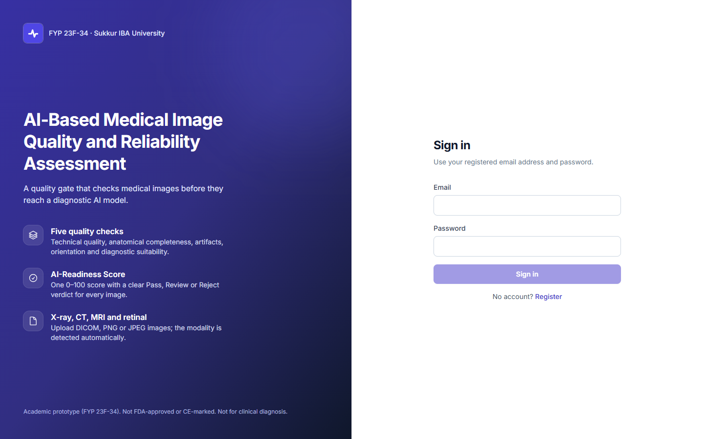
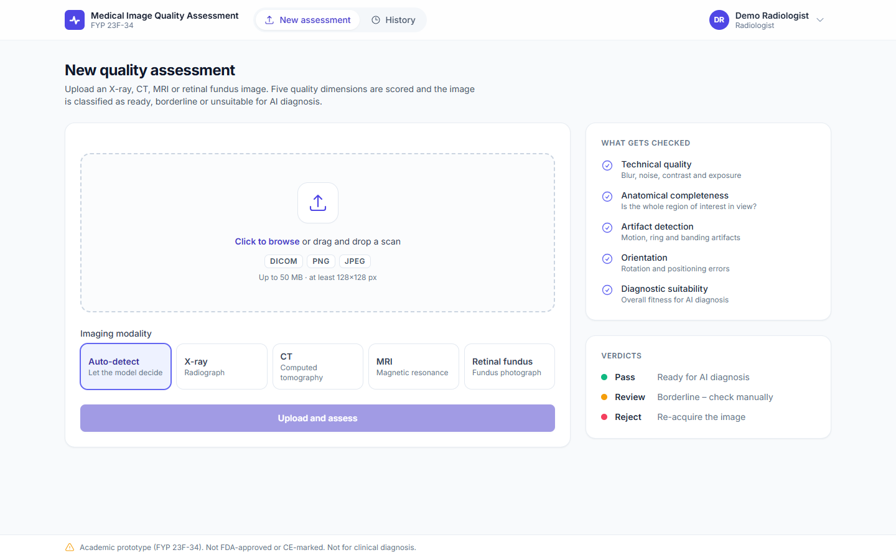
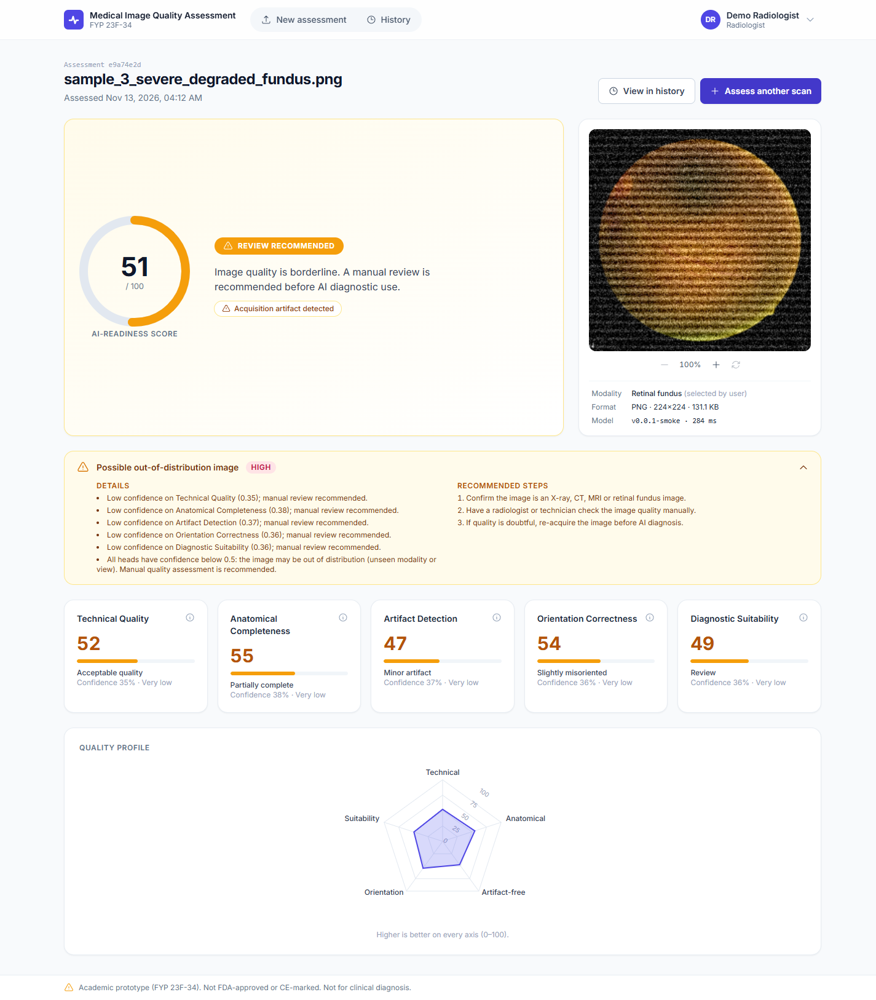
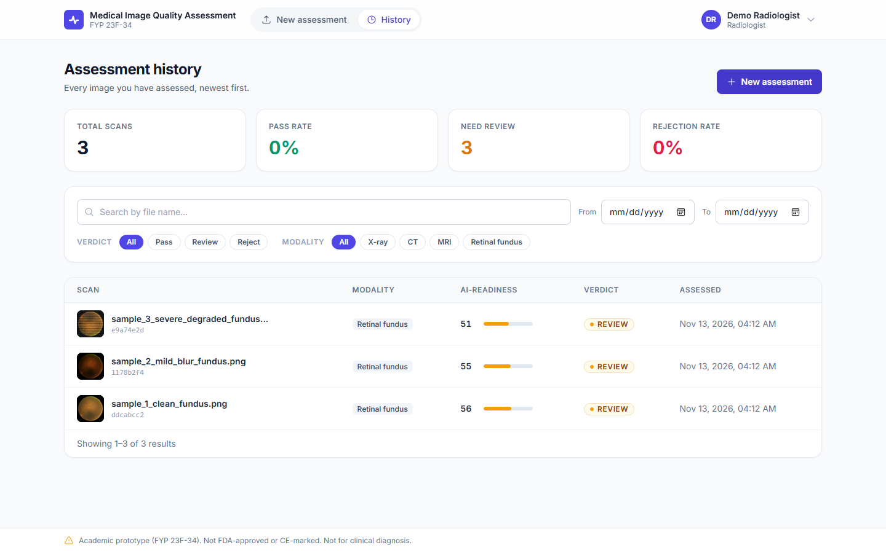

# AI-Based Medical Image Quality and Reliability Assessment

FYP 23F-34, Sukkur IBA University. Team: Asadullah Shaikh, Muhammad Yakoob, Muhammad Ramzan.
Supervisor: Riaz Ali Soomro. Co-supervisor: Dr. Sher Muhammad Daudpota.

> Academic prototype. Not FDA-approved or CE-marked. Not for clinical diagnosis.

This repository contains the **30% milestone**: a working end-to-end slice. A user can log in, upload a
medical image (DICOM/PNG/JPEG), and have it scored by the hybrid **EfficientNet-B4 + ViT-B/16** model on five quality heads.
The result is an **AI-Readiness Score** and a **Pass / Review / Reject** verdict, shown in the React dashboard.
What is implemented, and the design decisions behind it, are listed in [docs/MILESTONE_30.md](docs/MILESTONE_30.md).

```
ml/         Python package iqa_ml: preprocessing, synthetic degradation, model, training, evaluation
            scripts/ (prepare_data, export_degraded, train, evaluate) · notebooks/train_colab.ipynb · tests/
backend/    FastAPI + SQLAlchemy + Alembic + PostgreSQL · scripts/ (create_admin, register_model) · tests/
frontend/   React 18 + Vite + Tailwind + Axios + Recharts
docs/       milestone documentation
```

## Prerequisites
- Python 3.10+ (developed with 3.13), Node.js 18+ (developed with 24), PostgreSQL 14+ (developed with 16)
- A GPU is only needed for training (use Google Colab). Inference runs on CPU.

## 1. Python environment (once)
```powershell
cd "d:\Fyp claude"
python -m venv .venv
.\.venv\Scripts\Activate.ps1
pip install torch torchvision --index-url https://download.pytorch.org/whl/cpu
pip install -e "ml[data,dev]"
pip install -r backend\requirements.txt
```

## 2. Database (once)
Create two databases in PostgreSQL (pgAdmin or `psql -U postgres`):
```sql
CREATE DATABASE iqa;
CREATE DATABASE iqa_test;   -- used by the backend tests (wiped on every test run)
```
Copy `backend\.env.example` to `backend\.env` and set `DATABASE_URL`, `TEST_DATABASE_URL` and `JWT_SECRET`.
Then create the schema and an administrator:
```powershell
cd backend
alembic upgrade head
python scripts\create_admin.py --name "Admin" --email admin@example.com --username admin
```

## 3. Train a model (Google Colab GPU)
1. Zip the `ml\` folder as `ml.zip` and upload it to Google Drive at `MyDrive/iqa/ml.zip`.
2. Open `ml/notebooks/train_colab.ipynb` in Colab, choose a GPU runtime, and run all cells.
   It downloads MedMNIST+ (X-ray, CT, retinal) and IXI (MRI), trains with checkpoints saved to Drive (resumable),
   evaluates on the test split and downloads `v1.0.0.pt`.
3. Put the file at `backend\models\v1.0.0.pt` and register it:
```powershell
cd backend
python scripts\register_model.py --checkpoint models\v1.0.0.pt --activate
```
Before the Colab model is ready, a CPU smoke model can be trained locally to exercise the pipeline
(its accuracy is meaningless):
```powershell
cd ml
python scripts\prepare_data.py --source medmnist --modalities retinal --out data\prepared --max-per-modality 200   # small download
python scripts\train.py --manifest data\prepared\manifest.csv --out-dir runs\smoke --version v0.0.1-smoke --epochs 2 --batch-size 8 --freeze-backbone --max-train-samples 96 --max-eval-samples 30 --num-workers 0
copy runs\smoke\best.pt ..\backend\models\v0.0.1-smoke.pt
cd ..\backend
python scripts\register_model.py --checkpoint models\v0.0.1-smoke.pt --activate
```

## 4. Run the application
Two terminals:
```powershell
# terminal 1 – API on http://127.0.0.1:8000 (docs at /docs)
cd backend
..\.venv\Scripts\Activate.ps1
uvicorn app.main:app --port 8000

# terminal 2 – dashboard on http://localhost:5173
cd frontend
npm install      # once
npm run dev
```
Open http://localhost:5173, register, and upload an image.

### Demo accounts (local database only)
| Role | Email | Password |
|---|---|---|
| Administrator | admin@example.com | Admin1234 |
| Radiologist | demo.radiologist@example.com | Demo1234 |

The demo radiologist already has three assessed sample images. The same files are in `docs/demo_images/`
(clean, mildly blurred and severely degraded versions of one RetinaMNIST fundus image) for uploading during a demo.
`/health` shows model details only to administrators.

### Screenshots
| Sign in | New assessment |
|---|---|
|  |  |
| **Results** | **History** |
|  |  |

The scores in the screenshots come from the CPU smoke model (`v0.0.1-smoke`) and are not meaningful.

## 5. Tests
```powershell
cd ml;       python -m pytest            # preprocessing, degradation, scoring, model, training scripts
cd backend;  python -m pytest            # API against the iqa_test PostgreSQL database
cd frontend; npm run lint; npm test; npm run build
```

## Moving or renaming the project folder
The virtual environment stores absolute paths. After moving the folder, run once from the new location:
`powershell -ExecutionPolicy Bypass -File .\fix_after_rename.ps1`

## Data sources and licences
- MedMNIST+ (ChestMNIST from NIH ChestX-ray14, OrganAMNIST from LiTS, RetinaMNIST from DeepDRiD), CC BY 4.0.
- IXI dataset (T1 brain MRI), CC BY-SA 3.0.
- Your own de-identified data (e.g. full ChestX-ray14, EyePACS, BraTS slices) via
  `prepare_data.py --source folder --raw <dir with xray/ ct/ mri/ retinal/ subfolders>`.
